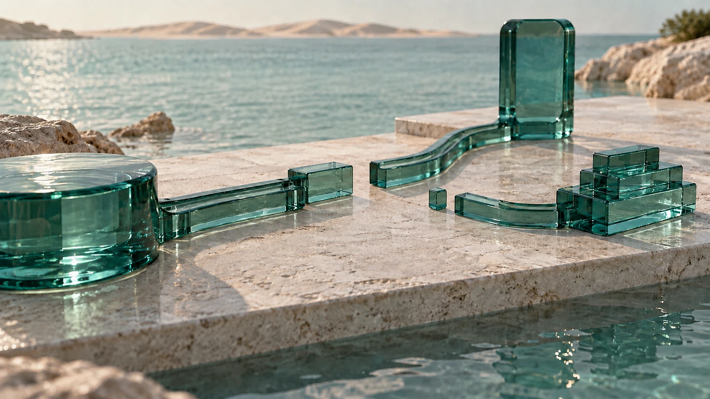

# A connection you control

Approved OpenFinance-OS permission film · 14 October 2026

The user approved the new script and concept, reviewed the generated eight-second film, and authorized homepage integration. This replaces the orbital illustration in the “Connected through permission.” section with a distinct scene in the existing hero's coastal glass style. The hero film and the original Open Circuit source assets remain unchanged.

## Story and placement

A rounded personal source controls a telescoping glass connection to one selected destination. The lower branch stays disconnected and unlit. A restrained amber reflection follows the joined upper route, then the selected connection retracts and the scene returns to a quiet closed state. The film illustrates permission, scope and withdrawal; it conveys no live traffic, transaction or participant-status evidence.

The full 16:9 frame is visible on desktop and mobile so both routes can be seen. Semantic light/dark surfaces replace the old fixed dark illustration panel. The heading, description, framework link and playback controls remain coded UI. The scene plays silently once when viewed, supports keyboard pause/play/replay, pauses offscreen or when hidden, and retains the responsive still until playback succeeds. Reduced-motion and data-saving visits do not automatically fetch or play the video; explicit playback is available.

The user's approved replacement supersedes earlier Open Circuit retention guidance for this section. Its legacy source movie and poster are retained as separate assets; they are no longer used by this component.

## Media provenance

- Generation: Higgsfield, Wan 3.0 (`wan3_0`), silent 1080p output.
- Opening job: `ca324fc5-5b60-4456-bdc0-bccfb173367c`, four seconds, closed → selected open connection.
- Closing job: `89679aef-3d5a-4d1d-adbd-125b6a877873`, four seconds, selected open → closed connection.
- Assembly: lossless join at their shared open reference frame. No crossfade or composited motion.
- Web film: `public/media/permission-connection.mp4`, eight seconds, 1920 × 1080, 24 fps, H.264/yuv420p, fast-start, no audio, 1,580,237 bytes.
- Film SHA-256: `088892c78b49af7f956b556d9a20bb1eb4ec0288c45a995e5ff2b95540cc7534`.
- Poster: approved closed concept, 1672 × 941, encoded as WebP. Astro generates viewport-sized variants at quality 78.

The first full-length generated take was rejected because the connector detached from its source and the reflection continued after withdrawal. The accepted revision preserves source-side continuity, keeps the lower branch quiet and makes the upper outgoing amber neutral before the selected gap reopens. Remaining source/head light fades by approximately 6.1 seconds. Generated movement timings are approximate to the approved storyboard. The four-second join and full decode were checked before integration.

## Validation

Homepage media, fallbacks, viewport framing, both themes and the unchanged hero are checked against the integration build. Local checks and preview results are recorded in the pull request. Integration is reviewable before production publication.
