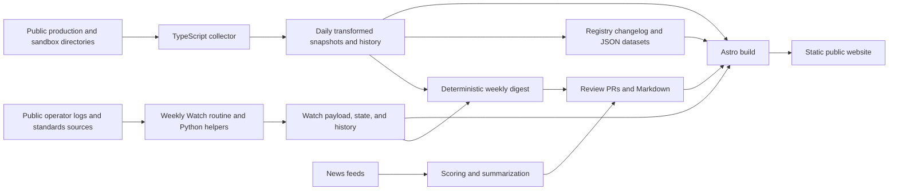

# OpenFinance-OS: codebase and user-value review

Reviewed 8 October 2026 · local revision `06f9da8` on `main` · public website checked alongside the repository.

## Assessment

Delivery update, 8 October 2026: the [credibility and access batch](./2026-10-08-credibility-and-access-implementation.md) and [principal user tasks batch](./2026-10-08-principal-user-tasks-implementation.md) are implemented. The findings below describe the original review baseline; the delivery notes record behavior and local validation, with release status recorded separately in GitHub. Public feedback routing and practitioner task sessions remain pending.

OpenFinance-OS has a valuable foundation: an independent historical record of UAE Open Finance, backed by public directory observations, operational analysis, and reusable community resources. Its greatest opportunity is to help a practitioner **answer a question, assess the evidence, and decide what to do next**.

The site currently makes visitors do too much interpretation. They encounter several different meanings of “live,” statistics whose labels exceed what the underlying fields establish, news without a clear UAE implication, and separate interfaces for registry and operational evidence. Some important information is lost during collection. The public contribution paths also fail for anonymous visitors.

I recommend improving credibility and access first, then making the existing evidence useful for comparison, monitoring, and briefing. A framework replacement, a large community platform, or a general AI assistant would deliver less immediate value than these changes.

At the time of the original review, this was an analysis and implementation proposal; application code, data, dependencies and deployment configuration had not been changed.

## Purpose and intended users

The July repositioning plan gives the clearest existing product direction: independent ecosystem tracking, historical evidence, international context, and neutral community resources, with technical integration handed to the operator. The current hero and About page largely follow that direction. The README, Learn landing page, and older PRDs retain a broader developer-hub promise.

The proposed purpose is:

> Help people working in UAE Open Finance understand what is available, what has changed, what the evidence establishes, and where to act next.

This is a product recommendation inferred from the repository and public journeys. No user interviews or analytics reports were available, so the audience ranking below is a hypothesis to validate.

| Potential user | Question they need answered | Value the site can provide | Current friction |
|---|---|---|---|
| Bank or fintech product/strategy lead | Which capabilities are available, and what changed since our last review? | A dated adoption view, comparisons, and a short briefing | Registration, published APIs, approvals, and traffic are presented across different pages and definitions |
| Developer or solution architect evaluating an integration | Which participants publish the required family/version, and where are the authoritative docs? | Evidence-backed coverage and a direct operator handoff | Missing families, inconsistent terminology, and Learn cards promising technical depth they do not deliver |
| Bank delivery or compliance team | Which published changes affect our release planning? | A sourced change register, affected audiences, and links to the governing material | The Watch is detailed but detached from the main interface; observations can read like stronger compliance conclusions |
| Researcher, journalist, or policy analyst | Can I reproduce and cite a claim about adoption? | Downloadable data, historical context, definitions, and durable references | Registry datasets exist, but operational data and cross-country comparisons lack equivalent publishing structure |
| Newcomer, student, or adjacent business professional | What does Open Finance enable, and how do I understand the ecosystem? | Plain-language concepts, use-case examples, and a path into the tools | Acronyms arrive early; several definitions conflict; the community page addresses developers |
| Contributor or subject expert | How can I correct a fact or share a useful resource? | An accessible submission path and visible review process | Linked repositories return 404 anonymously; the documented process requires a fork and PR |

Prioritize the first two groups for task testing. They connect the independent record to concrete decisions. Researchers are a strong secondary audience because citations and reusable data can increase the resource's reach. Consumer education can start with a small, plain-language overview; the current codebase does not establish a consumer service or product-comparison proposition.

## What the codebase actually delivers

The runtime is an Astro static website hosted through Cloudflare Pages. It has a small production dependency set: Astro, RSS, and sitemap integrations. Markdown collections hold news and Commons resources; most Learn and Global content lives directly in Astro pages. Client scripts handle filtering, search, themes, and analytics. This is an appropriate architecture for publishing public observations and educational content.

The current repository contains 69 news articles, including 52 marked external, and six Commons entries. There are 238 dated production snapshots and 245 sandbox snapshots. The aggregated production history contains 233 points, so archival coverage and time-series coverage should be described separately. The local build reports 204 generated pages.

The latest committed directory observations are from 7 October. The Watch's latest data run is 5 October, with logs through 29 September. These are separate observation clocks. Their differences are expected, but should be made explicit wherever the data is combined.

Important strengths to preserve:

- Daily observations and a changelog derived from committed snapshots make the historical record inspectable.
- Stable registry JSON endpoints, attribution, licensing, and observation dates already serve researchers.
- The Watch has substantial substance: standards changes, adoption evidence, operational volumes, payment acceptance, concentration, and source links.
- Watch calculations use deterministic helpers, integer money arithmetic, payload checks, and explicit full/partial-month distinctions.
- The main site already has global search, participant filtering with URL persistence, RSS, sitemap generation, structured data, themes, chart labels, and a table alternative in the homepage record.
- Operator-pointer pages reduce the burden of maintaining duplicate integration documentation.

The old `IMPROVEMENT_PLAN.md` is partly obsolete. Search, RSS, Open Graph metadata, structured data, shared city utilities, analytics, and chart labels are present. Future planning should begin from the current implementation rather than repeat that backlog.

## Confirmed findings and their user impact

### 1. The homepage's production count uses the wrong definition

**Priority: immediate.** The public homepage labels 27 as “Live in Production.” `ObservatoryPreview.astro` calculates this as registrations present in both environments plus production-only registrations. It ignores the `production.live` value already passed by the homepage. The Observatory's corresponding authorization-server count is 12.

Sandbox presence is similarly labeled “Testing in Sandbox,” although presence does not prove active testing. The hero describes all 27 registrations as connected financial institutions and calls the daily snapshot live data. The directory also contains technical and other non-bank registrations.

**User impact:** a visitor can report a materially different adoption picture depending on which section they read.

**Change:** label the existing counts “Registered in production” and “Registered in sandbox.” Label the authorization-server measure explicitly. Reserve traffic claims for a stated log window and scope. Explain directory `Active` as a registration status. Use “Daily directory snapshot” with its observation date.

**Evidence:** [homepage calculation](/Users/michartmann/Documents/GitHub/community-website/src/components/home/ObservatoryPreview.astro:41), [hero labels](/Users/michartmann/Documents/GitHub/community-website/src/components/home/Hero.astro:41), [collector's proxy](/Users/michartmann/Documents/GitHub/community-website/scripts/collect-observatory.ts:107). The collector sets `isLive` from an active authorization server with an issuer; it does not test service availability.

### 2. Active insurance and ATM resources disappear during collection

**Priority: immediate.** The collector maps only four API families. A direct read of the public production `/participants` endpoint on 8 October found active insurance resources for ADNIC and LIVA and an active ATM resource for HSBC. They are excluded by the mapping. Participant pages also hard-code the same four banking families.

**User impact:** insurance users see a website called Open Finance that omits their published capabilities. Researchers and developers receive an incomplete capability picture.

**Change:** preserve every raw family identifier, provide reviewed display labels for known families, and retain unfamiliar families with an explicit label until reviewed. Display version, certification status, and `FamilyComplete`. Add a fixture test proving that unknown families survive transformation. Introduce a definition/schema version so older snapshots remain understandable without inventing historical coverage.

**Evidence:** [family allowlist](/Users/michartmann/Documents/GitHub/community-website/scripts/collect-observatory.ts:59), [resource filtering](/Users/michartmann/Documents/GitHub/community-website/scripts/collect-observatory.ts:91), [participant family list](/Users/michartmann/Documents/GitHub/community-website/src/pages/observatory/participant/[slug].astro:132), [public production source](https://data.directory.openfinance.ae/participants).

### 3. Two registrations collide on the same profile URL

**Priority: immediate.** The production snapshot contains two Mercury records with different organization IDs. Both produce the slug `mercury`. One has BDSP/BSIP roles; the other has TSP/API Read_Write roles. The public profile displays only the latter role set.

**User impact:** a visitor following the first record's card can reach a profile for a different registration. The ambiguity also affects search and makes unique-organization claims harder to interpret.

**Change:** give each registration a stable URL based on its ID or an ID-backed slug. Keep display names separate from identity. If an organization-level view groups registrations, make that grouping explicit and retain each registration's roles and evidence. Do not merge distinct IDs solely because names match. Preserve existing URLs through reviewed redirects or an explicit choice page.

**Evidence:** [slug generation](/Users/michartmann/Documents/GitHub/community-website/src/pages/observatory/participant/[slug].astro:20), the production snapshot, and [public Mercury profile](https://openfinance-os.org/observatory/participant/mercury/).

### 4. Several headline metrics represent fields rather than the population named by their labels

**Priority: high.** TPP count is calculated using `roles.includes('TPP')`. The public `/roles` response checked during this review uses BDSP, BSIP, ISP, LFI, TSP, API Read_Write, and pki-test-harness; there is no literal TPP role in that response. Consequently, “TPPs: 0” is not an established count of third-party businesses.

“Shariah Compliant: 1 — Islamic finance institutions” reflects one directory flag, while the repository's profiles classify both ADIB and DIB as Islamic banks. That demonstrates a difference between classification and field coverage, not grounds to overwrite the directory. All 16 authorization-server records returned by the production endpoint had the three capability fields present and false; the zeros reflect the upstream declarations rather than verified behavior.

**User impact:** precise-looking zeros or small counts can be interpreted as absence of institutions or capabilities when the metric actually describes a narrower field.

**Change:** distinguish entity classification, technical roles, source declarations, and verified observations. Use labels such as “Directory records with Shariah flag.” Explain the basis of each metric at the point of use. Establish a reviewed classification source before publishing a TPP entity count; otherwise show that count as unavailable.

**Evidence:** [TPP counting](/Users/michartmann/Documents/GitHub/community-website/scripts/collect-observatory.ts:302), [flag extraction](/Users/michartmann/Documents/GitHub/community-website/scripts/collect-observatory.ts:112), and [existing limitations](/Users/michartmann/Documents/GitHub/community-website/src/pages/observatory/methodology.astro:271).

### 5. Role terminology conflicts across the site and with the directory documentation

**Priority: high.** Participant profiles call BDSP “Business Data Service Provider” and BSIP “Business Service Integration Provider.” The Observatory uses other expansions, and the glossary uses still others. ISP is described as an information service provider.

The referenced Trust Framework documentation identifies BDSP as Bank Data Sharing Provider, BSIP as Bank Service Initiation Provider, and ISP as Insurance Service Provider. Its role table also explains what participants receive those scopes. [Trust Framework role documentation](https://openfinanceuae.atlassian.net/wiki/spaces/TFDocsv5/pages/235077660/Trust%2BFramework%2BUser%2BDocumentation).

**User impact:** newcomers learn incorrect expansions, while practitioners cannot rely on consistent terminology.

**Change:** maintain one sourced, versioned terminology dictionary shared by cards, profiles, Learn, methodology, and search. Include plain-language meaning alongside the expansion. Treat organization type and application permissions separately.

**Evidence:** [profile definitions](/Users/michartmann/Documents/GitHub/community-website/src/pages/observatory/participant/[slug].astro:140), [glossary](/Users/michartmann/Documents/GitHub/community-website/src/pages/learn/glossary.astro:38), [Observatory definitions](/Users/michartmann/Documents/GitHub/community-website/src/pages/observatory/index.astro:370).

### 6. The weekly digest presents changes to cumulative totals as weekly activity

**Priority: high.** The digest labels a delta in `totalFull` as API volume growth “WoW.” That field is the cumulative total across full months, excluding the current partial month. The 5 October digest says +0.0% WoW while the Watch reports that September's partial-month logs advanced. The comparison baseline is the previous recorded run, which can also be more than seven days earlier.

**User impact:** a reader can interpret an unchanged cumulative full-month total as flat current weekly activity. Deterministic generation guarantees repeatability, not the correctness of the interpretation.

**Change:** calculate non-overlapping, comparable seven-day windows when source coverage supports them. Otherwise state the change in the reported cumulative measure since the dated prior observation. Carry source cutoff, metric window, and completeness into the digest. Distinguish an unchanged measure from an unchanged feed. Add semantic assertions before automatic publication.

**Evidence:** [digest comparison](/Users/michartmann/Documents/GitHub/community-website/scripts/weekly-digest.ts:138), [published example](/Users/michartmann/Documents/GitHub/community-website/src/content/news/2026-10-05-weekly-digest.md:20), [Watch computation](/Users/michartmann/Documents/GitHub/community-website/tools/watch/of_watch_metrics.py:259).

### 7. Public contribution paths do not currently deliver the advertised experience

**Priority: immediate.** Anonymous HTTP checks returned GitHub 404 pages for `openfinance-os/community/issues`, `openfinance-os/community/discussions`, and `openfinance-os/community-website` and its issues path. The organization itself was accessible. The frequently used `/organizations/openfinance-os/` link redirected to a sign-in page for an organization dashboard.

These checks establish what an anonymous visitor encounters, not whether a repository was deleted; private repositories can return the same status.

**User impact:** “See an error?”, “Join Discussions,” and contribution instructions may lead to a dead end. Requiring a fork and Markdown PR additionally excludes many product, policy, and business contributors.

**Change:** verify and provide an accessible public feedback destination. A separate public discussions/issues repository is one option if the website source is intentionally private. Link the public organization overview directly. Add prefilled correction submissions with page URL and observed date, and accept plain-language resource suggestions. Maintain review and the public correction history.

**Evidence:** [community page](/Users/michartmann/Documents/GitHub/community-website/src/pages/community/index.astro:183), [Commons process](/Users/michartmann/Documents/GitHub/community-website/src/pages/commons/contribute.astro:149), [homepage GitHub link](/Users/michartmann/Documents/GitHub/community-website/src/pages/index.astro:68), and the anonymous checks above.

### 8. Search exists, but common questions fail and its state display is broken

**Priority: high.** Desktop searches for `CIBA` and `v2.2` returned no results. Consent returned a Commons title, but the index does not include glossary entries, page bodies, or the Watch's standards changes. News and Commons indexing is primarily title-based. An `ADCB` search returned four items while also visibly showing “No results found”: `.search-empty { display: flex }` overrides the hidden state.

At 390px width, the search trigger is hidden. Opening the mobile navigation did not make that trigger visible.

**User impact:** users cannot find concepts or changes central to the site's purpose, and valid matches appear to be unsuccessful.

**Change:** repair hidden-state styling and provide mobile search. Generate a static index containing glossary terms, meaningful page sections, participant families, and dated Watch changes. Support a query URL and useful empty-state suggestions. Load the index on demand instead of embedding more content into every page.

**Evidence:** [index fields](/Users/michartmann/Documents/GitHub/community-website/src/components/common/SearchDialog.astro:161), [static page index](/Users/michartmann/Documents/GitHub/community-website/src/components/common/SearchDialog.astro:453), [empty-state styling](/Users/michartmann/Documents/GitHub/community-website/src/components/common/SearchDialog.astro:1116), [hidden mobile actions](/Users/michartmann/Documents/GitHub/community-website/src/components/common/Header.astro:449).

### 9. The strongest analytical tool feels like a separate site

**Priority: high.** The Watch has its own dark interface and section navigation. It provides no link back to the website home and no main/header/navigation landmarks or skip link. A browser visit with JavaScript disabled produced an empty body with no fallback. Its HTML is static in hosting terms, but its visible content is generated in the browser.

The first-screen five-topic summary, dated alerts, and source links are useful. Preserve that hierarchy while improving integration.

**User impact:** readers lose the surrounding navigation, assistive navigation is weaker, and a script failure can remove the main analytical resource entirely.

**Change:** add a shared site entry/return path immediately. Render core summaries, dates, and tables at build time; keep interaction as enhancement. Introduce consistent Observatory tabs for Registry, Adoption & Activity, Changes, and Data & Methodology. Port sections incrementally, keeping the calculation pipeline intact.

**Evidence:** [standalone endpoint](/Users/michartmann/Documents/GitHub/community-website/src/pages/observatory/watch/index.html.ts:38), [client renderer](/Users/michartmann/Documents/GitHub/community-website/tools/watch/watch.template.html:196), public desktop inspection, and the no-JavaScript check.

### 10. Discovery copy and content selection undermine the positioning

**Priority: medium.** Learn advertises an implementation guide and technical deep dive, but those destinations are now conceptual introductions with operator pointers. The homepage's four latest stories were all global external articles during inspection, while the site's own UAE digest appeared lower on Updates. Recent UAE-tagged stories include general AI/cloud and business-account news whose specific Open Finance relevance is not explained.

The Global benchmark mixes TPPs, banks, ASPSPs, institutions, and data holders in one participant column. Its hard-coded figures have no individual source, as-of date, or comparability note.

**User impact:** the site promises the wrong depth, obscures its original analytical work, and invites invalid comparisons.

**Change:** make Learn cards accurately describe the introduction and handoff. Feature the latest independent UAE briefing on the homepage. Require a concrete UAE Open Finance implication for selected international stories. Give benchmark observations a source, definition, unit, date, and review owner; compare common measures only where definitions permit it.

**Evidence:** [Learn promises](/Users/michartmann/Documents/GitHub/community-website/src/pages/learn/index.astro:4), [pointer destination](/Users/michartmann/Documents/GitHub/community-website/src/pages/learn/tpp-guide.astro:14), [homepage date-only selection](/Users/michartmann/Documents/GitHub/community-website/src/components/home/LatestNews.astro:15), [Global values](/Users/michartmann/Documents/GitHub/community-website/src/pages/global/index.astro:14).

## Improvements that would create the most new value

### A. A decision-ready adoption and coverage view

Let a visitor select an environment, service family, and version, then inspect a sortable participant table. Each row should distinguish registration, published resources, declared certification/completeness, approval evidence where available, and successful traffic observed in a named period. Every value should have an observation date and source.

Use explicit states: evidence present, evidence absent in a defined source/window, unknown, stale, and not applicable. Lack of public logs should not become a claim that a service is unavailable. Preserve the Watch's distinction between payment acceptance and settlement.

An example task is: “Which organizations publish insurance data-sharing APIs, and where is recent usage evidenced?” Today a visitor cannot reliably complete that task through the registry. This view would serve evaluators, delivery teams, and researchers simultaneously.

Start with a common evidence model and existing datasets. The operator's own API-discovery documentation describes the directory as published authorization-server and API metadata; its homepage separately names activity measures by a 30-day traffic window. That separation is useful precedent for the site's terminology. [API discovery](https://www.nebras-open-finance.com/tech/tpp-standards/trust-framework/api-discovery), [operator homepage](https://www.nebras-open-finance.com/).

### B. Participant comparison and a dated evidence timeline

Allow comparison of two or three registrations by API family/version, completeness, declared certification, and observations. Link each difference to the source and date. Add a participant timeline using the existing changelog, and cross-link relevant Watch observations and source documents.

Prioritize these fields over generic ownership, founding date, and promotional descriptions. Keep those details as supplementary context. Avoid a single “best bank” score: the evidence should support a user's specific requirement.

A shared comparison URL and a downloadable table would let a practitioner use the result in a meeting without manually transcribing cards.

### C. An independent briefing people can use every week

Put a compact briefing near the top of the homepage:

| Item | Reader question answered |
|---|---|
| Observed change | What changed, compared with which dated observation? |
| Affected audience | Does this concern my role or use case? |
| Implication | What does the evidence suggest, with uncertainty stated? |
| Next step | Which official document, comparison, or dataset should I inspect? |
| Source and cutoff | Can I verify and cite it? |

Reuse the Watch's existing summary and registry diffs. Separate measured changes from editorial interpretation. Publish a focused registry-change/Watch feed in addition to the broad news RSS. Test demand for subscriptions before building accounts and email preferences. A local saved filter or watchlist can make repeat visits easier without a subscription backend.

### D. Citable data products and exports

Extend the existing Data page with operational datasets that can be reproduced and published under appropriate source terms, documented schemas, definition versions, coverage windows, and quality status. Distinguish source observations from derived analysis. Retain immutable dated versions and publish CSV alongside JSON where users work in spreadsheets.

Provide “Copy citation,” “Download this filtered table,” and chart exports carrying the metric definition, period, and source. Model changes should be visible in a dataset changelog. Capture gaps should be visible rather than interpolated as observations.

This is a strong fit for the independent-record proposition and can encourage legitimate citations and reuse. Availability of public feeds alone does not establish their stability or redistribution terms; record that dependency explicitly before offering a supported data interface.

### E. A small set of use-case pathways

Create focused pages for SME cash-flow visibility, pay-by-bank, credit assessment, and insurance data sharing. Each should combine a plain-language explanation, required capabilities, observed ecosystem coverage, one relevant Commons resource, and the operator documentation handoff.

The Data Sandbox is a useful discovery asset, but the website should explain what a user can learn from it and that its personas are synthetic. A visitor should understand how a demonstration relates to published capabilities and what it does not establish about production use.

For international context, compare adoption, experience, and outcomes with compatible definitions. Open Banking Limited's impact-report approach illustrates the value of measuring those dimensions separately; transaction volume alone does not establish customer benefit. This is a design inference, not a claim that the same underlying measures are available in the UAE. [OBL impact-report approach](https://www.openbanking.org.uk/insights/latest-impact-report-shows-strong-growth-and-the-power-of-payments/).

### F. A usable community and maintained Commons

Make correction and suggestion submissions accessible first. Add an owner, last reviewed date, relevant standard/version, maintenance status, and a specific “how to use this” step to Commons entries. Distinguish original publication date from review date. Require the contextual explanation already described in the editorial policy for references.

Start with a visible request list: update a definition, verify a source, improve a resource, or contribute a worked example. Recognize helpful contributions through attribution. The current six-entry collection does not establish demand for expert directories, points, leaderboards, OAuth, or a contact platform; validate participation before committing to that roadmap.

## Technical direction

**Architecture recommendation: retain static publishing and strengthen the data and rendering boundaries. Status: proposed.** The core constraints are maintainability, independently inspectable observations, low operating overhead, and accurate public presentation.

| Option | Assessment | Appropriate trigger |
|---|---|---|
| Existing Astro architecture with shared schemas, identity, taxonomy, and build-time rendering | Best fit for the next improvements; uses the current archive and delivery path | Current public information and comparison tasks |
| Static publishing with a narrow backend for subscriptions/submissions | Adds storage, delivery, moderation, and privacy work | Validated demand for notifications or submissions that existing public tools cannot satisfy |
| Full authenticated community platform and general AI assistant | Largest operating and governance burden; retrieval would still inherit current data errors | Evidence of sustained community activity and a tested need beyond search and structured views |

The first option makes correctness easier to enforce, though observation freshness remains dependent on upstream feeds and collection jobs. Review the need for a backend after task tests and repeat-usage evidence.

Suggested implementation boundaries:

- Add a shared `src/lib/observatory-data.ts` access layer with runtime validation and a typed view model. Replace repeated compatibility handling and broad `any` casts.
- Add an ID-backed participant identity helper and one taxonomy/terminology module. Use them in production, sandbox, profiles, search, and datasets.
- Extract collector transformation and summarization into testable functions that do not fetch, write, or publish on import.
- Consolidate production/sandbox page and profile views. The four files currently total 5,134 lines; shared rendering would reduce the places where a definition can diverge.
- Separate collection time, source cutoff, last successful observation, last attempted check, and status. Keep last-known-good data with a visible stale/partial-source state.
- Validate Watch payload semantics during the Astro build, in addition to checking that its JSON parses. Run its Python test scripts in CI.
- Gate content Markdown changes with schema/build checks. `ci.yml` currently ignores all Markdown, including content collections.
- Repair the collector validation workflow: its import invokes the script, failures are suppressed with `|| true`, the dry run continues on error, and the summary still claims compilation succeeded.
- Expand health monitoring beyond HTTP availability to directory/Watch freshness, dataset integrity, and the public contribution destination.
- Keep behavioral tests tied to meaningful user outcomes: consistent definitions, preserved resource families, unique profile routes, valid search states, comparable digest windows, and readable Watch content without scripts.

Performance work should follow measurement. The generated homepage is about 98 KiB, production Observatory 226 KiB, and sandbox Observatory 414 KiB before transfer compression. Those are artifact sizes, not network-transfer or Core Web Vitals results. Embedding the same search data in many pages is a candidate for lazy loading; do not add chart or search frameworks before measuring their effect.

Analytics is already extensive. Add task-completion events for comparison, evidence/source opening, dataset export, and successful handoff. The current search tracking sends free-text queries to PostHog; use topic classifications or minimized query reporting where sufficient, and explain collection clearly. Remote analytics settings, retention, and legal compliance were not audited.

## Prioritized delivery plan

These are planning ranges for one maintainer familiar with the repository, with access to an editorial reviewer. They are not delivery commitments; public contribution destinations and source agreements require separate owner decisions.

| Sequence | Work | Main files | Acceptance condition |
|---|---|---|---|
| First: credibility and access, roughly 1–2 weeks | Fix registration/live labels, preserve insurance/ATM and unknown families, resolve Mercury identity, correct taxonomy, repair search states/mobile access, correct Learn promises, verify public feedback paths, fix digest semantics | Collector and types; Hero/ObservatoryPreview; participant/search views; Learn; weekly-digest; community links | Every displayed count has a definition; all active source families survive; distinct records have distinct routes; valid search hides the empty state; public feedback works; no cumulative total is labeled weekly activity |
| Next: the principal user tasks, roughly 2–4 weeks | Shared data model; coverage table; comparison and timeline; common Observatory navigation; build-rendered Watch summary; focused homepage briefing | New shared lib modules; Observatory views; Watch endpoint/template; homepage components; dataset endpoints | Test participants can answer a coverage question, compare two records, and identify the week's changes with dates and sources |
| Then: repeat use and reusable evidence, roughly 3–6 weeks | Filtered exports/citations; targeted feeds; Commons maintenance metadata; two initial use-case pathways; content review fields and quality CI | Data endpoints/page; RSS; content schemas; Commons; Learn/use-case pages; workflows | Users can reuse evidence without transcription, return to relevant changes, and submit a correction without editing code |
| Demand-led expansion | Personalized alerts, deeper global benchmarks, Arabic priority content, narrow AI query assistance, or expert/community features | Determined after discovery | Each investment is backed by repeated task failures or demonstrated demand |

The linked delivery notes record the file-specific plans, local changes and validation for the first two batches.

## How to validate increased user value

Recruit three product/delivery practitioners, three developers or architects, and two research/policy users for short task sessions. This is a proposed sample, not completed research.

Ask them to identify published coverage for a service, compare two participants, explain a status using its source, find a current standards change, cite a historical observation, and submit a correction. Record completion, elapsed time, wrong interpretations, and where they needed help. Ask what they currently use instead and what information they trust enough to put into a decision memo.

Proposed product measures:

| Measure | Why it matters | Initial decision criterion |
|---|---|---|
| Correct task completion with source/date | Tests whether the site supports decisions | Aim for at least 80% across the selected tasks; establish the baseline first |
| Correct distinction between registration, published capability, and traffic | Directly tests the main credibility problem | No participant should infer functioning service from registration alone |
| Time to an evidence-backed coverage answer | Measures usefulness of the new table | Target a material reduction from the observed baseline; initially test a two-minute goal |
| Repeat visits to briefing, coverage, or comparisons | Tests recurring value | Compare matched cohorts after enough traffic accumulates; no current return-rate claim is available |
| Dataset exports and externally observed citations | Tests reuse | Track alongside sources opened and briefing use, without treating every click as success |
| Usable suggestions and time to resolve factual corrections | Tests community accessibility and maintenance | Establish a review cadence and publish correction status |
| Data freshness and invalid/unknown source fields | Protects the evidence foundation | Explicit per-source status and a tested response when collection fails |

Avoid using page views, article count, or chat-message volume as the principal success measure. A short successful visit can be more valuable than a long session spent searching.

## Verification and limits

- `npm run build`: passed; 204 pages reported.
- `npm run test`: passed; 132 tests across six files.
- Existing Chromium E2E suite: passed; 30 tests against the local production preview. The first sandboxed attempt could not bind the preview port; the permitted local-preview run completed successfully.
- All six `tools/watch/test_of_watch_*.py` scripts: passed. They are self-contained scripts; standard unittest discovery does not execute their assertions.
- `npm run check`: did not complete a type check. Astro requested installation of the declared `@astrojs/check` dependency in the current local environment; the noninteractive command ended without diagnostics. An exit code of zero here is not evidence of type correctness. Dependencies were left unchanged.
- Live inspection covered Home, Observatory, a participant profile, Watch, Global, Commons, Community, Learn, Updates, and Data. Mobile overflow checks at 390px found no document-level horizontal overflow on Home, Observatory, Watch, or Global.
- Direct public production directory reads verified raw resource families, role names, and capability-field values. They were read-only and did not run the collector or change the saved observations.
- Public feedback/GitHub routes were checked anonymously. Authenticated access was not tested.
- No claim is made about full WCAG conformance, field performance, present CI status, upstream feed licensing, legal compliance, conversion, traffic, or user satisfaction. No automated external link crawl or security audit was performed.
- The Data Sandbox and other external tools were assessed through this website's descriptions and links; their separate codebases and user journeys were not audited.

Supporting screenshots: [desktop homepage](/Users/michartmann/Documents/GitHub/community-website/.playwright-mcp/analysis-home-desktop.png), [mobile homepage](/Users/michartmann/Documents/GitHub/community-website/.playwright-mcp/analysis-home-mobile.png), [Watch desktop](/Users/michartmann/Documents/GitHub/community-website/.playwright-mcp/analysis-watch-desktop.png).

The proposed product direction is a useful, citable decision resource: visitors should leave knowing what changed, what the evidence supports, and how to continue. The archive and Watch already provide most of the raw material. Accurate definitions, complete collection, accessible navigation, and task-focused views would turn that material into substantially greater user value.

## Open Finance skill follow-up — 8 October 2026

Applied the installed [UAE Open Finance skill](/Users/michartmann/.agents/skills/open-finance-uae/SKILL.md), including its LFI integration and source-provenance references, to the first implementation batch. This added a domain check beyond the original code and usability review.

The Learn pages still carried assumptions that would mislead a UAE integration team: a bank-owned OAuth authorization server, consent required for every API, DCR described as a customer authentication flow, and directory presence described as live operation. The local implementation now explains Hub mediation, Hub-owned consent and tokens, LFI customer authentication, Ozone Connect, and the distinction between consented customer services and client-credentials services. The methodology also treats environment presence as an observation rather than a certification or graduation event.

The skill's source guidance exposed a separate credibility issue. The [official Confluence overview](https://openfinanceuae.atlassian.net/wiki/spaces/OF/overview) is a documentation space, not participant registration. The [Nebras community LFI guide](https://www.nebras-open-finance.com/tech/lfi-api-hub) explicitly identifies its site as a community project, not an official CBUAE publication. Source labels and handoffs now distinguish those roles. Technical explanations were cross-checked against that guide, its consent journey material and the trust-framework guide; the installed skill's dated version and pricing summaries were not presented as current facts.

For user value, this strengthens the proposed integration comparison view: show published Hub-facing family/version metadata and its observation date, then link separately to reported operational evidence and governing documentation. Keep licence classification, directory permissions, certification declarations and traffic as distinct evidence. A consumer-facing use-case explanation can be added later, after practitioner task testing; the current site's strongest foundation remains independent observations and their interpretation.
